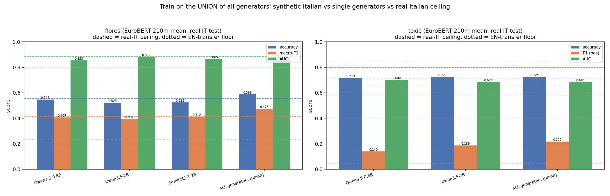

# All-paraphrases: union of every generator's synthetic Italian

We pool the synthetic Italian of **all available generators** into ONE training set and train the SAME fixed classifier (EuroBERT-**210m** mean -> XGBoost) used by `gen_compare.py`, then compare against each single generator, the **real Italian ceiling** and the **EN-transfer floor**, all evaluated on the **real Italian test**.

- Generators: `Qwen/Qwen3.5-0.8B`, `Qwen/Qwen3.5-2B`, `HuggingFaceTB/SmolLM2-1.7B-Instruct`.
- Union features = vertical stack of the per-generator mean embeddings (EuroBERT mean pooling is per-text, so this equals embedding the pooled text).
- XGBoost (CPU, fixed): hist, max_bin 64, cpu, n_jobs 2, seed 0, depth 8, mcw 5, lr 0.1, n 400 (FLORES `multi:softprob`; toxic `binary:logistic`).
- Generation: read from the `gen_compare` cache; **no generation was run**.

## Dataset: flores (real Italian test)

| arm | accuracy | macro-F1 | AUC | n_train |
|---|---|---|---|---|
| **ALL generators** | 0.5881 | **0.4749** | 0.8821 | 4503 |
| Qwen3.5-0.8B | 0.5465 | 0.4067 | 0.8533 | 1501 |
| Qwen3.5-2B | 0.5228 | 0.3968 | 0.8823 | 1501 |
| SmolLM2-1.7B | 0.5248 | 0.4125 | 0.8648 | 1501 |
| real_it (ceiling) | 0.5545 | 0.4149 | 0.8838 | 1501 |
| en_transfer (floor) | 0.4158 | 0.2332 | 0.7920 | 1501 |

- **Verdict:** UNION of 3 generator(s) reaches 0.4749 macro-F1 vs best single **SmolLM2-1.7B** 0.4125 (UNION WINS) and real-IT ceiling 0.4149 (114% of ceiling, +0.0599 vs ceiling); EN-transfer floor 0.2332.
- Combining all generators **beats** the best single generator.

## Dataset: toxic (real Italian test)

| arm | accuracy | F1 | AUC | n_train |
|---|---|---|---|---|
| **ALL generators** | 0.7251 | **0.2170** | 0.6836 | 16000 |
| Qwen3.5-0.8B | 0.7186 | 0.1402 | 0.6994 | 8000 |
| Qwen3.5-2B | 0.7234 | 0.1860 | 0.6840 | 8000 |
| real_it (ceiling) | 0.7965 | 0.5811 | 0.8420 | 18472 |
| en_transfer (floor) | 0.7095 | 0.0455 | 0.6535 | 8000 |

- **Verdict:** UNION of 2 generator(s) reaches 0.2170 F1 vs best single **Qwen3.5-2B** 0.1860 (UNION WINS) and real-IT ceiling 0.5811 (37% of ceiling, -0.3641 vs ceiling); EN-transfer floor 0.0455. (Missing generators: SmolLM2-1.7B.)
- Combining all generators **beats** the best single generator.

