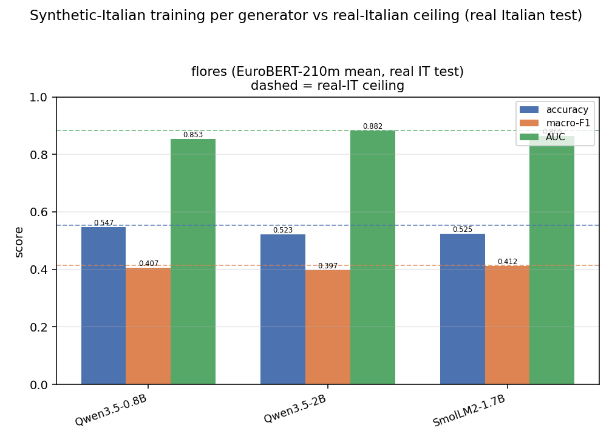

# Generator comparison: English -> Italian synthetic training text

Three small instruct LLMs generate **Italian** training text from the **English** training text with the cross-lingual rewrite template (`paraphrase_prompts.build_messages('crosslingual', src='English', tgt='Italian')`). EuroBERT-**210m** mean embeddings feed the SAME fixed XGBoost classifier, trained on each generator's synthetic Italian and evaluated on the **real Italian** test.

- Generators: `Qwen/Qwen3.5-0.8B`, `Qwen/Qwen3.5-2B`, `HuggingFaceTB/SmolLM2-1.7B-Instruct`.
- Decoding: greedy (`do_sample=False`), bf16, batch 16, max_new_tokens 384, `enable_thinking=False` when supported.
- XGBoost (CPU, fixed): hist, max_bin 64, cpu, n_jobs 2, seed 0, depth 8, mcw 5, lr 0.1, n 400  (FLORES `multi:softprob` 12-class; toxic `binary:logistic`).
- Datasets: **FLORES sent** (EN train+val 997+504=1501 -> IT; real IT test 505); **toxic** (`data/toxi_clean`; EN train capped to 8000, seed 0 -> IT; real IT test 2310).
- Reference rows: **real_it** (train on real Italian = ceiling) and **en_transfer** (train on the English source = cross-lingual floor).
- Generation: adaptive batch from `16` (step down on OOM); `torch.compile` (reduce-overhead, dynamic) = True; **duty cycle = 1.0** (GPU busy ~that fraction of wall time); VRAM cap = 1.0; below-normal priority = True.

## Generation throughput (bf16)

| generator | dataset | batch | duty | gpu-busy | rows/s | tok/s |
|---|---|---|---|---|---|---|
| Qwen3.5-2B | flores | 16 | 1.00 | 1.00 | 2.54 | 151 |
| SmolLM2-1.7B | flores | 16 | 1.00 | 1.00 | 0.66 | 81 |

- **Qwen3.5-2B** micro-bench (n=16, same prompts): eager 1.09 rows/s (79 tok/s) vs compiled 1.22 rows/s (89 tok/s).
- **SmolLM2-1.7B** micro-bench (n=16, same prompts): eager 1.46 rows/s (152 tok/s) vs compiled 1.16 rows/s (121 tok/s).

## Dataset: flores (12-class, accuracy/macro-F1/AUC)

### Backbone EuroBERT-210m (EuroBERT/EuroBERT-210m)

| generator | accuracy | macro-F1 | AUC |
|---|---|---|---|
| Qwen3.5-0.8B | 0.5465 | 0.4067 | 0.8533 |
| Qwen3.5-2B | 0.5228 | 0.3968 | 0.8823 |
| SmolLM2-1.7B | 0.5248 | 0.4125 | 0.8648 |
| real_it (ceiling) | 0.5545 | 0.4149 | 0.8838 |
| en_transfer (floor) | 0.4158 | 0.2332 | 0.7920 |

- Ranking by macro-F1: SmolLM2-1.7B (0.4125) > Qwen3.5-0.8B (0.4067) > Qwen3.5-2B (0.3968).
- Best generator **SmolLM2-1.7B** = 0.4125 macro-F1 vs real-IT ceiling 0.4149 (99% of ceiling) and EN-transfer floor 0.2332.

### Sample generations (flores)

**Qwen3.5-0.8B**

- EN: On Monday, scientists from the Stanford University School of Medicine announced the invention of a new diagnostic tool that can sort cells by type: a tiny printable chip that can be manufactured using standard inkjet printers for possibly about one U.S. cent each.
  - IT (Qwen3.5-0.8B): _Il 1º gennaio, i ricercatori del Dipartimento di Medicina dell'Università di Stanford hanno annunciato l'invenzione di un nuovo strumento diagnostico che permette di classificare i tessuti in base al loro tipo: una piccola chip stampabile che può essere prodotta utilizzando i normali impressori a inchiostro per un costo stimato di circa un centesimo americano._
  - FLORES IT ref: Nella giornata di lunedì, alcuni scienziati della Scuola di Medicina dell'Università di Stanford hanno annunciato l'invenzione di un nuovo strumento diagnostico capace di ordinare le cellule in base al tipo: un chip minuscolo che può essere stampato utilizzando stampanti a getto di inchiostro al costo di circa 1 centesimo di dollaro l'uno.
- EN: The Sun doesn't have a crust like the Earth that you can stand on. The whole Sun is made out of gases, fire, and plasma.
  - IT (Qwen3.5-0.8B): _Il Sole non ha una crosta simile a quella dell'aria su cui si può fermarsi. L'intero Sole è composto da gas, fuoco e plasma._
  - FLORES IT ref: Il Sole, diversamente dalla Terra, non ha una crosta su cui poggiarsi. L'intero Sole è formato da gas, fuoco e plasma.
- EN: Unlike larger vehicles, you are probably already familiar with driving your car and know its limitations.
  - IT (Qwen3.5-0.8B): _- Confrontate con veicoli più grandi, poiché probabilmente già vieni familiarizzato con il conducente del tuo auto e con le sue limitazioni._
  - FLORES IT ref: Rispetto ai mezzi più grandi, avrete sicuramente già una certa dimestichezza con la vostra auto, e ne conoscete i limiti.
- EN: Entertainment news website TMZ understands the photographer stopped his vehicle on the other side of Sepulveda Boulevard and attempted to take pictures of the police stop before crossing the road and continuing, prompting the California Highway Patrol police officer conducting the traffic stop to order him back across, twice.
  - IT (Qwen3.5-0.8B): _La newsela TMZ di TMZ comprende che il fotografo ha fermato il proprio veicolo sulla strada opposta a Sepulveda Boulevard e ha tentato di prendere foto della stop della polizia prima di attraversare la strada e continuare, il che ha portato all'ordine del poliziotto della California Highway Patrol che lo ha portato indietro, due volte._
  - FLORES IT ref: Da quanto appreso dal sito web di notizie di intrattenimento TMZ, il fotografo ha fermato il suo veicolo dalla parte opposta di Sepulveda Boulevard e ha cercato di fotografare l'ufficiale di polizia che dirigeva il traffico allo stop, poi ha attraversato la strada e ha proseguito, costringendo l'ufficiale di polizia della California Highway Patrol che stava effettuando il controllo del traffico allo stop a intimargli per due volte di tornare indietro.
- EN: This too can be borrowed from the stock at the entrance but that clothing isn't washed after every user so you may not feel comfortable wearing these skirts. One size fits all for men!
  - IT (Qwen3.5-0.8B): _Questo stesso vestito può essere preso dal magazzino all'ingresso, ma la vestita non viene lavata dopo ogni utente, quindi non si sentirà confortevole indossando queste sciarpe. Uno per tutti per gli uomini!_
  - FLORES IT ref: Anche questi possono essere presi in prestito presso il magazzino all'ingresso; tuttavia gli indumenti non vengono lavati dopo ogni utente, per cui indossando queste gonne potreste non sentirvi a vostro agio. Per gli uomini, una taglia unica per tutti!

**Qwen3.5-2B**

- EN: On Monday, scientists from the Stanford University School of Medicine announced the invention of a new diagnostic tool that can sort cells by type: a tiny printable chip that can be manufactured using standard inkjet printers for possibly about one U.S. cent each.
  - IT (Qwen3.5-2B): _"Il 1° lunedì, scienziati della Stanford University School of Medicine hanno annunciato l'invenzione di un nuovo strumento diagnostico in grado di classificare le cellule per tipo: un chip di stampa microscopico che può essere prodotto utilizzando stampanti a inchiostro standard per circa un centesimo di dollaro a pezzo."_
  - FLORES IT ref: Nella giornata di lunedì, alcuni scienziati della Scuola di Medicina dell'Università di Stanford hanno annunciato l'invenzione di un nuovo strumento diagnostico capace di ordinare le cellule in base al tipo: un chip minuscolo che può essere stampato utilizzando stampanti a getto di inchiostro al costo di circa 1 centesimo di dollaro l'uno.
- EN: The Sun doesn't have a crust like the Earth that you can stand on. The whole Sun is made out of gases, fire, and plasma.
  - IT (Qwen3.5-2B): _Il Sole non ha una crosta come la Terra su cui si può camminare. L'intero Sole è composto da gas, fuoco e plasma._
  - FLORES IT ref: Il Sole, diversamente dalla Terra, non ha una crosta su cui poggiarsi. L'intero Sole è formato da gas, fuoco e plasma.
- EN: Unlike larger vehicles, you are probably already familiar with driving your car and know its limitations.
  - IT (Qwen3.5-2B): _A differenza dei veicoli più grandi, è probabile che tu sia già familiare con il conduzione del tuo auto e ne conosca i limiti._
  - FLORES IT ref: Rispetto ai mezzi più grandi, avrete sicuramente già una certa dimestichezza con la vostra auto, e ne conoscete i limiti.
- EN: Entertainment news website TMZ understands the photographer stopped his vehicle on the other side of Sepulveda Boulevard and attempted to take pictures of the police stop before crossing the road and continuing, prompting the California Highway Patrol police officer conducting the traffic stop to order him back across, twice.
  - IT (Qwen3.5-2B): _Il sito web TMZ di intrattenimento ha capito che il fotografo ha fermato il suo veicolo sul lato opposto della Boulevard di Sepulveda e ha tentato di scattare foto della fermazione dei poliziotti prima di attraversare la strada e continuare, costringendo l'ufficiale della California Highway Patrol che conduceva la fermata di traffico a ordinarlo di tornare indietro, due volte._
  - FLORES IT ref: Da quanto appreso dal sito web di notizie di intrattenimento TMZ, il fotografo ha fermato il suo veicolo dalla parte opposta di Sepulveda Boulevard e ha cercato di fotografare l'ufficiale di polizia che dirigeva il traffico allo stop, poi ha attraversato la strada e ha proseguito, costringendo l'ufficiale di polizia della California Highway Patrol che stava effettuando il controllo del traffico allo stop a intimargli per due volte di tornare indietro.
- EN: This too can be borrowed from the stock at the entrance but that clothing isn't washed after every user so you may not feel comfortable wearing these skirts. One size fits all for men!
  - IT (Qwen3.5-2B): _"Questo può essere preso in prestito dal vestito d'ingresso, ma quel capo non viene lavato dopo ogni utente, quindi non si sentirà a suo agio indossando queste felpette. Una taglia unica per i maschi!"_
  - FLORES IT ref: Anche questi possono essere presi in prestito presso il magazzino all'ingresso; tuttavia gli indumenti non vengono lavati dopo ogni utente, per cui indossando queste gonne potreste non sentirvi a vostro agio. Per gli uomini, una taglia unica per tutti!

**SmolLM2-1.7B**

- EN: On Monday, scientists from the Stanford University School of Medicine announced the invention of a new diagnostic tool that can sort cells by type: a tiny printable chip that can be manufactured using standard inkjet printers for possibly about one U.S. cent each.
  - IT (SmolLM2-1.7B): _"Domenica, gli scienziati dall'Università di Stanford della Scuola di Medicina hanno annunciato l'invenzione di un nuovo strumento di diagnosi che può separare le cellule da tipo: un chip tessile a base di inkjet printer, producibile utilizzando standard per uno sconto di un dollaro americano."_
  - FLORES IT ref: Nella giornata di lunedì, alcuni scienziati della Scuola di Medicina dell'Università di Stanford hanno annunciato l'invenzione di un nuovo strumento diagnostico capace di ordinare le cellule in base al tipo: un chip minuscolo che può essere stampato utilizzando stampanti a getto di inchiostro al costo di circa 1 centesimo di dollaro l'uno.
- EN: The Sun doesn't have a crust like the Earth that you can stand on. The whole Sun is made out of gases, fire, and plasma.
  - IT (SmolLM2-1.7B): _Il Sole non ha un crusto come il pianeta Terra che puoi stare sulla. Tutta l'Urano è composta da gas, fuoco e plasma._
  - FLORES IT ref: Il Sole, diversamente dalla Terra, non ha una crosta su cui poggiarsi. L'intero Sole è formato da gas, fuoco e plasma.
- EN: Unlike larger vehicles, you are probably already familiar with driving your car and know its limitations.
  - IT (SmolLM2-1.7B): _"Invece di più grandi macchinari, potrebbe essere accorto di guidare il tuo auto e saperne le loro limitazioni."_
  - FLORES IT ref: Rispetto ai mezzi più grandi, avrete sicuramente già una certa dimestichezza con la vostra auto, e ne conoscete i limiti.
- EN: Entertainment news website TMZ understands the photographer stopped his vehicle on the other side of Sepulveda Boulevard and attempted to take pictures of the police stop before crossing the road and continuing, prompting the California Highway Patrol police officer conducting the traffic stop to order him back across, twice.
  - IT (SmolLM2-1.7B): _Il sito di entusiasma TMZ è sicuro che il fotografo ha perso il proprio auto sulla sinistra dell'autostrada di Sepulveda e ha tentato di prendere foto del stop di polizia prima di passare l'autostrada e continuare, promissionando che l'officer di polizia California ha ordinato a volte di tornare a passare, due volte._
  - FLORES IT ref: Da quanto appreso dal sito web di notizie di intrattenimento TMZ, il fotografo ha fermato il suo veicolo dalla parte opposta di Sepulveda Boulevard e ha cercato di fotografare l'ufficiale di polizia che dirigeva il traffico allo stop, poi ha attraversato la strada e ha proseguito, costringendo l'ufficiale di polizia della California Highway Patrol che stava effettuando il controllo del traffico allo stop a intimargli per due volte di tornare indietro.
- EN: This too can be borrowed from the stock at the entrance but that clothing isn't washed after every user so you may not feel comfortable wearing these skirts. One size fits all for men!
  - IT (SmolLM2-1.7B): _""" Questo è anche possibile prenotare dall'argento nell'entrata, ma questa veste non è lavata ogni volta, così potresti non sentire bene wearin' queste scarpe. Un'unita' è disponibile per i loro. """_
  - FLORES IT ref: Anche questi possono essere presi in prestito presso il magazzino all'ingresso; tuttavia gli indumenti non vengono lavati dopo ogni utente, per cui indossando queste gonne potreste non sentirvi a vostro agio. Per gli uomini, una taglia unica per tutti!

## Verdict

- **flores**: best generator **SmolLM2-1.7B** reaches 0.4125 macro-F1 = **99%** of the real-Italian ceiling (0.4149); EN-transfer floor 0.2332. Ranking: SmolLM2-1.7B (0.4125) > Qwen3.5-0.8B (0.4067) > Qwen3.5-2B (0.3968).
