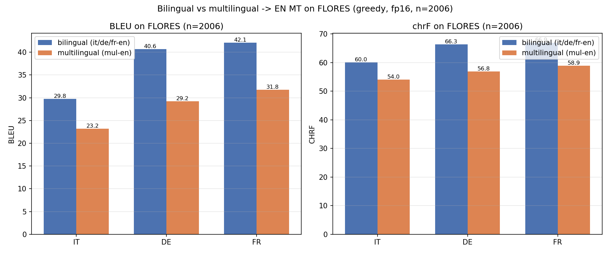

# Bilingual vs multilingual -> EN MT on FLORES

- Data: `flores200_en_it_de_fr.csv` — **2006 rows** (full set), gold reference = the **en** column.
- Pipeline: MarianMT seq2seq, fp16=True, greedy (`num_beams=1`), batch=64, max_length=512, device=cuda, torch threads=2.
- Bilingual: `opus-mt-it-en`, `opus-mt-de-en`, `opus-mt-fr-en`; Multilingual: `opus-mt-mul-en` (single many→en model for it/de/fr).
- Metrics: sacrebleu corpus **BLEU** and **chrF**, detokenized default settings.

## Results (BLEU / chrF)

| Language | Bilingual BLEU | Bilingual chrF | Multilingual BLEU | Multilingual chrF |
|---|---|---|---|---|
| it | 29.77 | 60.01 | 23.16 | 54.02 |
| de | 40.65 | 66.35 | 29.22 | 56.82 |
| fr | 42.07 | 66.89 | 31.79 | 58.90 |
| **macro (it,de,fr)** | **37.50** | **64.42** | **28.05** | **56.58** |

**Delta (multilingual − bilingual):** BLEU -9.44, chrF -7.84 (positive = multilingual better).

## Verdict

> The single multilingual `opus-mt-mul-en` model **falls short of** the three bilingual models on FLORES: macro BLEU 28.05 vs 37.50 (-9.44), macro chrF 56.58 vs 64.42 (-7.84).

