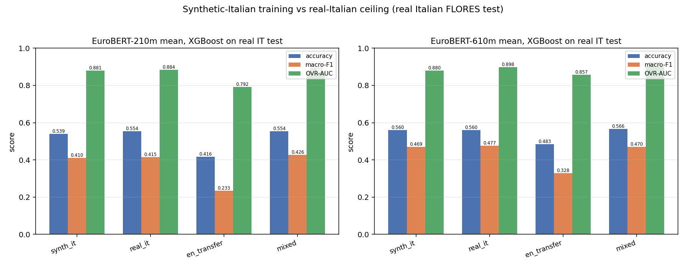

# Training on LLM-generated Italian, testing on REAL Italian FLORES

Small instruct generator **`HuggingFaceTB/SmolLM3-3B`** with a fixed rewrite prompt produces Italian training text from the **English** FLORES train+val sentences (997+504=1501). EuroBERT **mean** embeddings feed a fixed XGBoost topic classifier, evaluated on the **real Italian** FLORES test (505).

- Prompt (system): _"You rewrite/translate English text into natural Italian, preserving meaning; output only the Italian text."_.
- Decoding: greedy (`do_sample=False`), bf16, batch 16, max_new_tokens 384, `enable_thinking=False` when supported.
- Data: FLORES `sent` (12-class), train=dev 997 / val=504 / test=505 (seed-0). Features = **RAW** EuroBERT mean (matching `train_flores12` "full").
- XGBoost (CPU, fixed): `multi:softprob`, num_class 12, hist, max_bin 64, n_jobs 2, seed 0, depth 8, mcw 5, lr 0.1, n 400. Trained on the arm's own train+val.
- Arms: **synth_it** (synthetic IT), **real_it** (ceiling), **en_transfer** (EN), **mixed** (EN + synthetic IT).

## Example generations (source EN -> generated IT, and the FLORES IT reference)

- **EN:** On Monday, scientists from the Stanford University School of Medicine announced the invention of a new diagnostic tool that can sort cells by type: a tiny printable chip that can be manufactured using standard inkjet printers for possibly about one U.S. cent each.
  - gen IT: _Il lunedì, i ricercatori della Stanford University School of Medicine hanno annunciato l'invenzione di un nuovo strumento diagnostico che può classificare le cellule per tipo: un piccolo chip stampabile che può essere prodotto utilizzando stampanti a inchiostro standard per un costo stimato di circa un centesimo statunitense._
  - flor IT ref: Nella giornata di lunedì, alcuni scienziati della Scuola di Medicina dell'Università di Stanford hanno annunciato l'invenzione di un nuovo strumento diagnostico capace di ordinare le cellule in base al tipo: un chip minuscolo che può essere stampato utilizzando stampanti a getto di inchiostro al costo di circa 1 centesimo di dollaro l'uno.
- **EN:** The Sun doesn't have a crust like the Earth that you can stand on. The whole Sun is made out of gases, fire, and plasma.
  - gen IT: _Il Sole non ha una crosta come la Terra, su cui potresti camminare. Il Sole è composto interamente da gas, fuoco e plasma._
  - flor IT ref: Il Sole, diversamente dalla Terra, non ha una crosta su cui poggiarsi. L'intero Sole è formato da gas, fuoco e plasma.
- **EN:** Unlike larger vehicles, you are probably already familiar with driving your car and know its limitations.
  - gen IT: _A differenza dei veicoli più grandi, probabilmente sei già abituato a guidare la tua auto e conosci le sue limitazioni._
  - flor IT ref: Rispetto ai mezzi più grandi, avrete sicuramente già una certa dimestichezza con la vostra auto, e ne conoscete i limiti.
- **EN:** Entertainment news website TMZ understands the photographer stopped his vehicle on the other side of Sepulveda Boulevard and attempted to take pictures of the police stop before crossing the road and continuing, prompting the California Highway Patrol police officer conducting the traffic stop to order him back across, twice.
  - gen IT: _Il sito web di notizie sull'intrattenimento TMZ ha appreso che il fotografo ha fatto fermare il suo veicolo dall'altra parte della Sepulveda Boulevard e ha cercato di scattare foto della fermata della polizia prima di attraversare la strada e proseguire. Questo ha spinto l'agente della California Highway Patrol che stava conducendo la fermata stradale a ordinargli di tornare sull'altra parte della strada, due volte._
  - flor IT ref: Da quanto appreso dal sito web di notizie di intrattenimento TMZ, il fotografo ha fermato il suo veicolo dalla parte opposta di Sepulveda Boulevard e ha cercato di fotografare l'ufficiale di polizia che dirigeva il traffico allo stop, poi ha attraversato la strada e ha proseguito, costringendo l'ufficiale di polizia della California Highway Patrol che stava effettuando il controllo del traffico allo stop a intimargli per due volte di tornare indietro.
- **EN:** This too can be borrowed from the stock at the entrance but that clothing isn't washed after every user so you may not feel comfortable wearing these skirts. One size fits all for men!
  - gen IT: _Anche questo può essere preso in prestito dalla cassa all'ingresso, ma la biancheria non viene lavata dopo ogni utente, quindi potresti non sentirti a tuo agio a indossare queste gonna. Una taglia unica per uomini!_
  - flor IT ref: Anche questi possono essere presi in prestito presso il magazzino all'ingresso; tuttavia gli indumenti non vengono lavati dopo ogni utente, per cui indossando queste gonne potreste non sentirvi a vostro agio. Per gli uomini, una taglia unica per tutti!

## Backbone 210m (EuroBERT/EuroBERT-210m, 768-d)

| arm | accuracy | macro-F1 | OVR-AUC |
|---|---|---|---|
| synth_it | 0.5386 | 0.4103 | 0.8809 |
| real_it | 0.5545 | 0.4149 | 0.8838 |
| en_transfer | 0.4158 | 0.2332 | 0.7920 |
| mixed | 0.5545 | 0.4258 | 0.8726 |

- synthetic / real-IT ceiling (macro-F1) = **0.410 / 0.415 = 0.99**.
- vs EN-transfer (+0.177); mixed 0.426 (+0.011 vs ceiling, +0.193 vs EN-transfer).

## Backbone 610m (EuroBERT/EuroBERT-610m, 1152-d)

| arm | accuracy | macro-F1 | OVR-AUC |
|---|---|---|---|
| synth_it | 0.5604 | 0.4691 | 0.8804 |
| real_it | 0.5604 | 0.4770 | 0.8976 |
| en_transfer | 0.4832 | 0.3275 | 0.8565 |
| mixed | 0.5663 | 0.4702 | 0.9013 |

- synthetic / real-IT ceiling (macro-F1) = **0.469 / 0.477 = 0.98**.
- vs EN-transfer (+0.142); mixed 0.470 (-0.007 vs ceiling, +0.143 vs EN-transfer).

## Verdict

On EuroBERT-210m, synthetic-Italian training reaches **99%** of the real-Italian ceiling (macro-F1 0.410 vs 0.415) -- i.e. it **approaches** the ceiling. It clearly beats EN-transfer (0.233) by +0.177 macro-F1; mixing EN + synthetic IT gives 0.426 (+0.193 vs EN-transfer).
