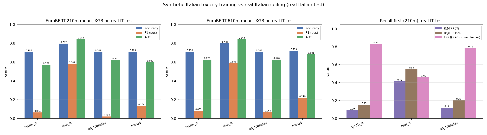

# Training on LLM-generated Italian, testing on the REAL Italian toxic test

Small instruct generator **`HuggingFaceTB/SmolLM3-3B`** with the cross-lingual rewrite prompt (`paraphrase_prompts.py`) produces Italian training text from the **English** toxic train (capped to **160** rows, seed 0). EuroBERT **mean** embeddings feed a fixed XGBoost toxicity classifier, evaluated on the **real Italian** toxic test (2310 rows).

- Prompt: cross-lingual rewrite (EN -> IT), `paraphrase_prompts.build_messages("crosslingual", src="English", tgt="Italian")`.
- Decoding: greedy (`do_sample=False`), bf16, batch 32, max_new_tokens 256, `enable_thinking=False` when supported.
- Data: `data/toxi_clean/` (binary `is_toxic`). EN train 24,000 -> cap 160; real IT train 18472; IT val 2310; **real IT test 2310** (positive rate 0.294).
- Features: **RAW** EuroBERT mean (bf16 forward -> fp32), read from `emb_bf16/toxic/<bb>/`; synthetic-IT embedded at runtime with the SAME pooling (no `perlang_z`, since the synthesis study must not use the target language's stats).
- XGBoost (CPU, fixed): `binary:logistic`, hist, max_bin 64, cpu, n_jobs 2, seed 0, depth 8, mcw 5, lr 0.1, n 400. Trained on each arm's own rows.
- Arms: **synth_it** (synthetic IT), **real_it** (ceiling), **en_transfer** (EN), **mixed** (EN + synthetic IT).

## Example generations (EN source -> generated IT)

- **EN:** When I went to University a couple of decades ago, a seat in my program was based purely on my high school grades. A meritocratic system (unlike say job interviews, where there is a lot more scope for discrimination).

So immigrant kids study harder, because their parents push them hard. Half the American kids today are from single parent or divorced families, and don't have a parent who can or wants to push them to study.
  - gen IT: _""" Quando sono andato all'università un paio di decenni fa, un posto nella mia classe era basato esclusivamente sui miei voti al liceo. Un sistema meritocratico (a differenza delle interviste di lavoro, dove c'è molto più spazio per la discriminazione). Quindi i bambini immigrati studiano di più, perché i loro genitori li spingono molto. Metà dei bambini americani oggi provengono da famiglie con un solo genitore o divorziati e non hanno un genitore che possa o voglia spingerli a studiare. """_
- **EN:** Don't be a sore loser, John.

Bernie wants the Superdelegates to vote for him. But if they vote for Hillary, then it's corrupt. You can't have it both ways.
  - gen IT: _""" Non essere un perdente amareggiato, John. Bernie vuole che i Superdelegati votino per lui. Ma se votano per Hillary, allora è corrotto. Non puoi avere le due cose. """_
- **EN:** Hmm...good to hear from the heads that believe 8th century stories.
  - gen IT: _""" Hmm...buona cosa sentire dai capi che credono alle storie del VIII secolo. """_
- **EN:** Is he talking about cutting oil tax credits? Boondoggles? the LIO? Legislative perks? Gas line executives and the gas marketing office in Houston, Texas?

I have the feeling he is talking about cutting troopers...and schools....again.

Did you notice how the legislature just had to cut $13M for schools at the last minute to save the budget, but had no problem spending $13M on another LIO they don't need? 

They have the wrong priorities and we must hold them accountable for the money they do have.

And I agree no new taxes.  The only way to get the amount of money we need is to get our historical share of oil tax profits.
  - gen IT: _"Sta parlando di tagliare i crediti fiscali sull'olio? Boondoggle? LIO? Permessi legislativi? Esecutivi della linea di gas a Houston, Texas? Ho l'impressione che stia parlando di tagliare i poliziotti...e le scuole...di nuovo. Hai notato come il legislatore abbia dovuto tagliare 13 milioni di dollari alle scuole all'ultimo momento per salvare il bilancio, ma non ha avuto problemi a spendere 13 milioni di dollari per un altro LIO che non serve? Hanno le priorità sbagliate e dobbiamo tenere conto del denaro che hanno. E concordo che non ci siano nuove tasse. L'unico modo per ottenere l'importo di denaro di cui abbiamo bisogno è ottenere la nostra quota storica dei profitti dell'olio."_
- **EN:** I don't &#128683; keep friends &#128109;&#128107;&#128108; they come &#128072; and go &#128073;, don't fuck &#128581; with these bitches &#128109;&#128109;. FAKE ALL THEY KNOW. &#128175;&#10004;&#65039;
  - gen IT: _"I non &#128683; conservo amici &#128109;&#128107;&#128108; perché vengono e vanno &#128072; e non mi fai schifo con queste puttane &#128109;&#128109;. Fingi tutto quello che sanno. &#128175;&#10004;&#65039; "_

## Backbone 210m (EuroBERT/EuroBERT-210m, 768-d)

| arm | accuracy | F1 (pos) | AUC | F1@val-thr |
|---|---|---|---|---|
| synth_it | 0.7069 | 0.0636 | 0.5709 | 0.4615 |
| real_it | 0.7965 | 0.5811 | 0.8420 | 0.6496 |
| en_transfer | 0.7082 | 0.0203 | 0.6211 | 0.4665 |
| mixed | 0.7091 | 0.1340 | 0.5971 | 0.4520 |

**Recall-first view** (threshold-free; train sizes: synth 160, real-IT 18472):

| arm | R@FPR5% | R@FPR10% | FPR@R90 |
|---|---|---|---|
| synth_it | 0.093 | 0.153 | 0.832 |
| real_it | 0.416 | 0.552 | 0.458 |
| en_transfer | 0.121 | 0.204 | 0.787 |

- synthetic / real-IT ceiling (F1) = **0.064 / 0.581 = 0.11**.
- vs EN-transfer (+0.043); mixed 0.134 (-0.447 vs ceiling, +0.114 vs EN-transfer).

## Backbone 610m (EuroBERT/EuroBERT-610m, 1152-d)

| arm | accuracy | F1 (pos) | AUC | F1@val-thr |
|---|---|---|---|---|
| synth_it | 0.7095 | 0.0821 | 0.6258 | 0.4750 |
| real_it | 0.7978 | 0.5878 | 0.8430 | 0.6396 |
| en_transfer | 0.7069 | 0.0688 | 0.6264 | 0.4696 |
| mixed | 0.7195 | 0.2193 | 0.6829 | 0.4971 |

**Recall-first view** (threshold-free; train sizes: synth 160, real-IT 18472):

| arm | R@FPR5% | R@FPR10% | FPR@R90 |
|---|---|---|---|
| synth_it | 0.102 | 0.180 | 0.789 |
| real_it | 0.385 | 0.556 | 0.427 |
| en_transfer | 0.124 | 0.202 | 0.781 |

- synthetic / real-IT ceiling (F1) = **0.082 / 0.588 = 0.14**.
- vs EN-transfer (+0.013); mixed 0.219 (-0.369 vs ceiling, +0.151 vs EN-transfer).

## Verdict

On EuroBERT-210m, synthetic-Italian training reaches only **11%** of the real-Italian ceiling (F1 0.064 vs 0.581) -- a large gap remains. It changes EN-transfer by +0.043 F1 (0.020) and mixing EN + synthetic IT gives 0.134 (-0.447 vs ceiling, +0.114 vs EN-transfer).
