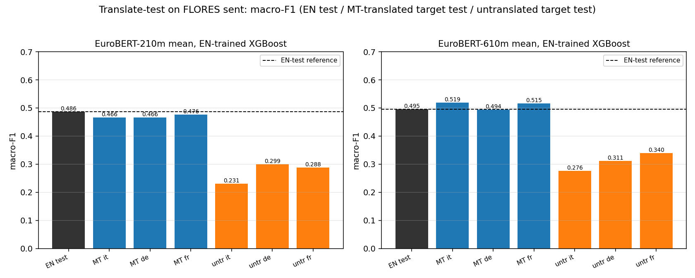

# FLORES sent translate-test: does MT-to-English recover English-level performance?

One **English-trained** `XGBClassifier` (EuroBERT mean, **feature space = English-space `perlang_z`**: L2-normalize + EN-train z-score).  The same model + same EN-train stats are evaluated on: the **original EN test** (reference), the **MT-translated target test** (`Helsinki-NLP/opus-mt-<lang>-en`, fp16 greedy), and the **untranslated target test**.  The **in-language ceiling** (native model on the target's own train+val, own-train `perlang_z`) is shown for context.

- Data: FLORES `sent` (12-class), train=dev 997 / val=504 / test=505 (seed-0 parallel split). XGBoost: `multi:softprob`, hist, max_bin 64, cpu, n_jobs 2, seed 0, depth 8, mcw 5, lr 0.1, n 400; trained on EN **train+val**.
- MT: greedy (`num_beams=1`), fp16, batch 64, max_length 512, device=cuda.
- Backbones: 210m (EuroBERT/EuroBERT-210m, 768-d), 610m (EuroBERT/EuroBERT-610m, 1152-d).

## Backbone 210m

EN-test reference: macro-F1 **0.486**, acc 0.606, OVR-AUC **0.904**.

| target | EN-test macro | MT macro | MT acc | MT auc | untr macro | untr acc | untr auc | ceiling macro | ceiling auc |
|---|---|---|---|---|---|---|---|---|---|
| it | 0.486 | 0.466 | 0.578 | 0.897 | 0.231 | 0.418 | 0.799 | 0.434 | 0.883 |
| de | 0.486 | 0.466 | 0.584 | 0.901 | 0.299 | 0.420 | 0.775 | 0.435 | 0.883 |
| fr | 0.486 | 0.476 | 0.582 | 0.896 | 0.288 | 0.420 | 0.816 | 0.467 | 0.874 |

- Transformed target/EN macro-F1 ratio (MT): it=0.957, de=0.958, fr=0.978 -- **MT reaches EN-level (ratio >= 0.9) in 3/3 targets**.
- MT vs untranslated (macro-F1): it 0.231->0.466 (+0.235), de 0.299->0.466 (+0.167), fr 0.288->0.476 (+0.188).
- 610m/210m note only where present; ratios to the in-language ceiling: it MT 0.466 / ceil 0.434, de MT 0.466 / ceil 0.435, fr MT 0.476 / ceil 0.467.

## Backbone 610m

EN-test reference: macro-F1 **0.495**, acc 0.612, OVR-AUC **0.910**.

| target | EN-test macro | MT macro | MT acc | MT auc | untr macro | untr acc | untr auc | ceiling macro | ceiling auc |
|---|---|---|---|---|---|---|---|---|---|
| it | 0.495 | 0.519 | 0.602 | 0.911 | 0.276 | 0.451 | 0.849 | 0.428 | 0.898 |
| de | 0.495 | 0.494 | 0.612 | 0.907 | 0.311 | 0.434 | 0.864 | 0.466 | 0.894 |
| fr | 0.495 | 0.515 | 0.590 | 0.914 | 0.340 | 0.461 | 0.851 | 0.437 | 0.876 |

- Transformed target/EN macro-F1 ratio (MT): it=1.050, de=0.998, fr=1.042 -- **MT reaches EN-level (ratio >= 0.9) in 3/3 targets**.
- MT vs untranslated (macro-F1): it 0.276->0.519 (+0.244), de 0.311->0.494 (+0.182), fr 0.340->0.515 (+0.175).
- 610m/210m note only where present; ratios to the in-language ceiling: it MT 0.519 / ceil 0.428, de MT 0.494 / ceil 0.466, fr MT 0.515 / ceil 0.437.

